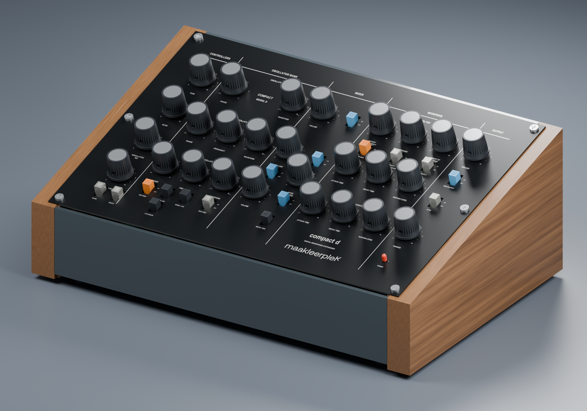
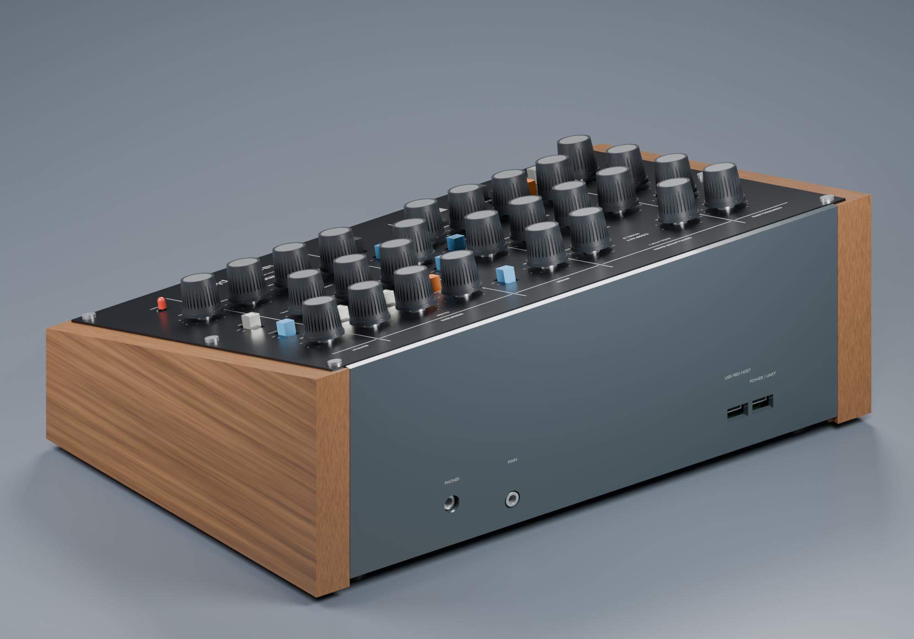
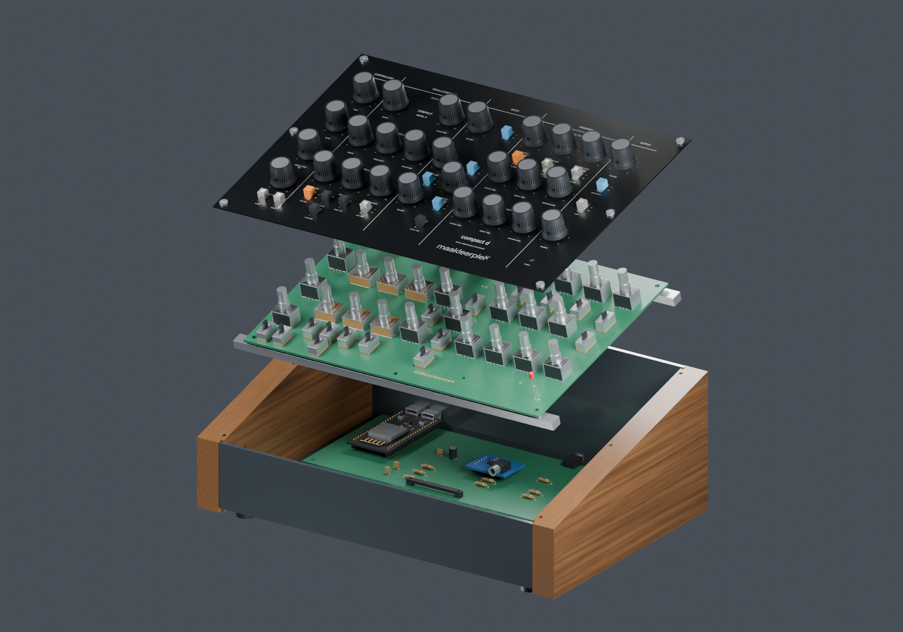
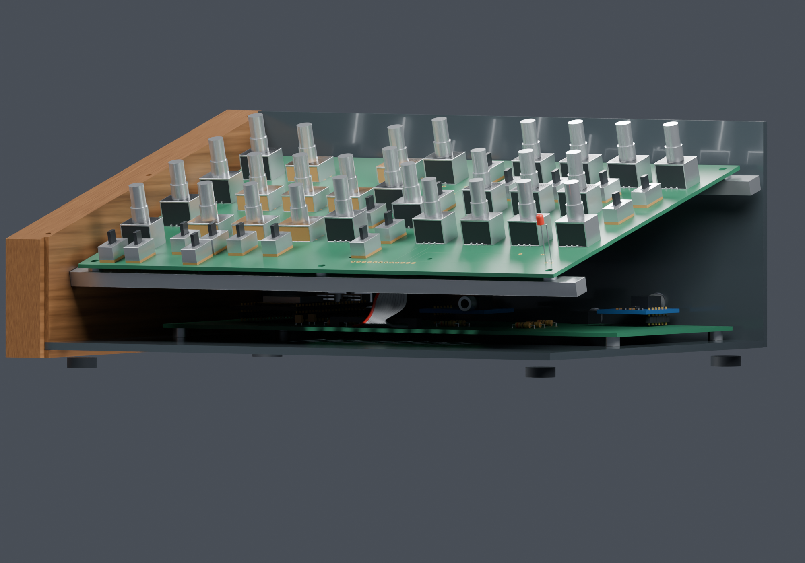
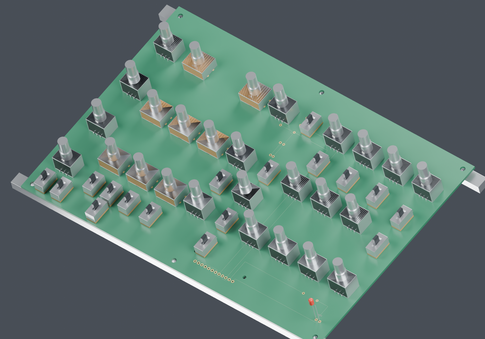

# Compact D — two-board sloped synthesizer

  

<table>
  <tr>
    <td width="50%"> <b>Rear</b> — audio jacks and USB ports</td>
    <td width="50%"> <b>Exploded</b> — panel, control PCB, rails and electronics PCB</td>
  </tr>
  <tr>
    <td width="50%"> <b>Interior</b> — sloped control board above the flat electronics board</td>
    <td width="50%"> <b>Control PCB</b> — 19 pots, 8 encoders, 17 switches</td>
  </tr>
</table>

Renders use reconstructed component models, not certified vendor CAD.

Active revision: [Split R0.5](hardware/split-r0.5/README.md).

A 220 × 150-mm control PCB under a 15° aluminium panel and a separate 210 × 90-mm electronics PCB, joined by a soldered 12-wire ribbon. CNC wooden sides, PMMA front/rear/bottom, classical printed knobs and the official maakleerplek wordmark. Panel screws now have dedicated clear borders.

- [Control PCB underside](hardware/split-r0.5/previews/control-pcb-underside.png)
- [Electronics PCB](hardware/split-r0.5/previews/electronics-pcb.png)
- [Control KiCad project](hardware/split-r0.5/control/control.kicad_pro)
- [Core KiCad project](hardware/split-r0.5/core/core.kicad_pro)
- [Electrical architecture and cable pinout](hardware/split-r0.5/architecture.md)
- [Enclosure and fabrication detail](mechanical/split-r0.5/README.md)
- [Laser engraving](mechanical/split-r0.5/panel-engraving-paths.svg)
- [Full CAD assembly](mechanical/split-r0.5/split-enclosure-and-boards.step)
- [Remaining verification](hardware/split-r0.5/remaining-verification.md)

Audio input removed. MCP internal contact pull-ups used. No added SMD packages on the carrier boards; purchased modules retain their factory SMD electronics. Current counts: 19 pots, 8 encoders, 17 switches and one power LED.

**Detailed design, not production-ready.** 53 known-pad connection trajectories are routed. Many final physical footprints are still unverified and their missing connections cannot be counted by DRC. Detailed renders use reconstructed component models, not certified vendor CAD. USB keyboard power from the ARCELI board remains unverified. No Gerbers or copper-milling release.

The [completion audit](hardware/split-r0.5/reports/completion-audit.json) compares the functional terminal list against actual KiCad pads: **246 required terminals currently lack matching pads, across 45 padless component instances**. These counts include functional module terminals whose physical mapping must still be established. Run `scripts/audit_completion_r05.py` with KiCad Python; it deliberately returns failure while completion blockers remain. A documented Same Sky SJ1-3523N candidate footprint is now available under `core/libraries/Documented.pretty`; it is **not yet installed on the active board**, because its board-edge and panel fit must be redesigned together.

Older revisions remain historical. The original specification is in `docs/projectspecification-v1.0.md`; decisions and user changes are in `docs/decisions.md`.
